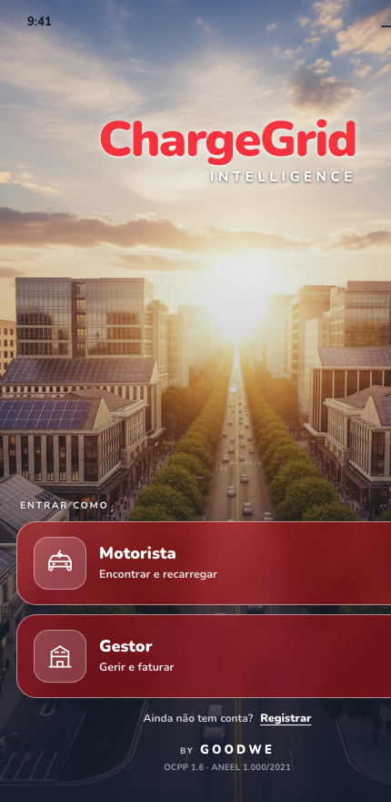

# ChargeGrid Intelligence ⚡

**Recarga compartilhada de veículos elétricos para galerias comerciais — do hardware ao app.**

*EV Challenge GoodWe + FIAP 2026 · Equipe EcovoltSquad*

  

A galeria gera energia solar no telhado, na fachada e no carport — e o gestor ganha duas vezes com o mesmo sol: vende recarga para carros elétricos (ficando com **90% da receita**) e abate a própria conta de luz com o que sobra. O motorista encontra recarga perto de onde já está. **O sol vira o novo sócio do gestor.**

---

## O que tem neste repositório

Um protótipo funcional de ponta a ponta, construído sprint a sprint:

| | O quê | Onde |
|---|---|---|
| 🔩 | **Carregador físico** — réplica 3D do GoodWe HCA G2 (a partir do CAD oficial) com ESP32, fita de LED atrás do logo W vazado e botão que faz o papel do plugue | [`modelo-3d/`](modelo-3d/) · [`esp32-led-demo/`](esp32-led-demo/) |
| 📱 | **App v1** — 110 KB, servido pelo próprio ESP32 no seu Access Point, sem internet | [`goodwe-mobile.html`](goodwe-mobile.html) |
| 📱 | **App v2 — ChargeGrid** — 39 telas, 3 personas (Motorista, Gestor, Prospect), integrado ao carregador físico | [`Sprint 3/Challenge_Goodwe_Sprint3-main/app/`](Sprint%203/Challenge_Goodwe_Sprint3-main/app/) |
| 🗄 | **Modelo de dados** — 15 tabelas PostgreSQL/Supabase, validado em Docker | [`banco-de-dados/`](banco-de-dados/) |
| 🎨 | **Design system** — tokens, 9 componentes e a regra "cor de status = cor do LED físico" | [`Sprint 3/Challenge_Goodwe_Sprint3-main/design-system/`](Sprint%203/Challenge_Goodwe_Sprint3-main/design-system/) |

## O ciclo físico completo

O botão do carregador impresso em 3D **é o plugue**: um clique conecta o cabo (LED âmbar respirando), o app libera a carga (verde girando atrás do W), um clique no meio da carga interrompe (vermelho respirando — e a cobrança pausa junto), e segurar 1,5 s reseta a demonstração inteira. A cor do poste é sempre a cor do status no app — é regra contratual do design system.

O ESP32 opera em **modo duplo de Wi-Fi**: cria a rede própria `GoodWe-Demo` (demo autossuficiente, sem internet) e entra também na rede local com IP fixo — assim o notebook mantém internet durante apresentações online, e o app encontra o carregador sozinho em qualquer dos dois endereços.

## A inteligência

- **Tarifa dinâmica** — o gestor define a base; a IA ajusta pelo solar disponível, demanda e horário de ponta. Toda saída de IA vem com uma linha de justificativa legível: número sem razão vira desconfiança no preço.
- **DLM (Dynamic Load Management)** — o teto das vagas é dinâmico: demanda contratada − pico da edificação − 12% de margem, repartido igualmente entre as vagas em carga. Potência reduzida é âmbar, não vermelho: é a galeria se protegendo da multa, não um erro.
- **Load shifting** — o Síndico Virtual prevê a demanda e recomenda comprar energia no momento mais barato.
- **Cobrança justa** — tarifa travada no plug-in, pré-autorização pelo valor da meta e captura só dos kWh entregues: o motorista nunca paga o que não recebeu.

## Arquitetura

  

Na arquitetura alvo, o Supabase é a **fonte única de verdade**: ESP32, motor de inteligência e app falam só com o banco — o firmware não decide nada, apenas reporta. A inteligência de tarifa, DLM e load shifting já está escrita e roda hoje no cliente com dados sintéticos; a migração para Edge Functions é o próximo passo. Referências normativas citadas na interface: **OCPP 1.6** e **ANEEL 1.000/2021**.

## Como rodar

**Demo física completa** — grave [`esp32-led-demo/esp32-led-demo.ino`](esp32-led-demo/esp32-led-demo.ino) num ESP32 (biblioteca Adafruit NeoPixel; copie `wifi_local.example.h` para `wifi_local.h` com a sua rede), conecte na rede `GoodWe-Demo` e abra `http://192.168.4.1`.

**Só o app v2** — dois cliques em [`Sprint 3/Challenge_Goodwe_Sprint3-main/app/dist/ChargeGrid-app.html`](Sprint%203/Challenge_Goodwe_Sprint3-main/app/dist/ChargeGrid-app.html): arquivo único autocontido, funciona sem servidor e sem internet. Sem o carregador por perto, o app detecta a ausência e a demo segue só na tela.

## Vídeo

🎬 [Apresentação da Sprint 3 no YouTube](https://www.youtube.com/watch?v=VSHhU_l0mKA)

## Equipe — EcovoltSquad

| RM | Nome | Papel |
|---|---|---|
| 572899 | **Patrick Fernandes Martins Pais** | **Scrum Master** |
| 571836 | Bruna Yukimy Hada | Desenvolvedora |
| 571562 | Denize Ferrante | Desenvolvedora |
| 570436 | Gabriel Del Pizzo Pintor | Desenvolvedor |
| 572395 | Gabriel Dias Menezes | Desenvolvedor |
| 570540 | Ian Rodrigues Martins | Desenvolvedor |

---

Trabalho acadêmico desenvolvido para o EV Challenge GoodWe + FIAP 2026. GoodWe, SEMS e HCA G2 são marcas de seus respectivos titulares; este não é um produto oficial da GoodWe.
