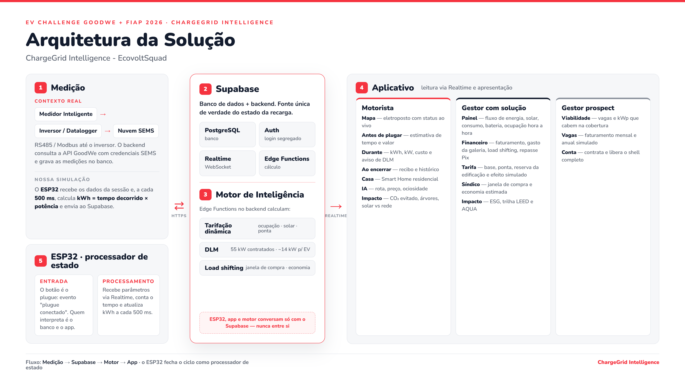

# ChargeGrid Intelligence

**EV Challenge GoodWe + FIAP 2026 · Sprint 3 · EcovoltSquad**

ChargeGrid transforma o carregador residencial GoodWe HCA G2 em um posto de recarga
compartilhada. Um aplicativo, dois papéis: o **motorista** encontra, pluga e paga; o
**gestor da galeria** controla demanda contratada, tarifa e repasse. A plataforma fica
com 10% de cada transação e o anfitrião recebe 90%.

Este repositório reúne o desenvolvimento do projeto até a Sprint 3: a demonstração
física com ESP32, o protótipo navegável do aplicativo, o modelo de dados e o design
system.



---

## O que tem aqui

| Pasta | O que é | Estado |
|---|---|---|
| [`demo-fisica/`](demo-fisica/) | **v1** — ESP32 + a interface servida por ele | ✅ **Funcional** · congelada · é o que roda no hardware |
| [`app/`](app/) | **v2** — protótipo navegável: 39 telas, 3 personas | 🔨 **Em desenvolvimento** · interface completa, sem back-end |
| [`banco-de-dados/`](banco-de-dados/) | Modelo PostgreSQL / Supabase, 15 tabelas | 📐 **Modelado** · ainda não provisionado |
| [`design-system/`](design-system/) | Tokens, 9 componentes e regras de conteúdo | ✅ **Estável** |
| [`docs/`](docs/) | Diagrama de arquitetura | — |

O banco de dados, o design system e os documentos servem as duas versões do app e por
isso ficam na raiz.

---

## Por que duas versões do aplicativo

A **v1** nasceu acoplada ao ESP32. A interface inteira cabe em ~110 KB porque precisa
caber no flash do microcontrolador, que a serve direto do próprio Access Point — sem
internet, sem notebook, sem servidor. Esse limite é o que a tornou uma boa prova de
conceito de hardware: ela fecha o ciclo completo, do botão físico ao LED, passando pela
medição e pela interface.

E é o mesmo limite que a tornou uma má base para o produto. As três personas do
ChargeGrid — motorista, gestor com a solução instalada e gestor prospect — somam 39
telas, tarifação dinâmica, DLM, simulador de viabilidade e painel financeiro. Isso não
cabe numa página servida por microcontrolador.

A **v2** foi refeita no Claude Design para validar essa experiência inteira, e herdou da
v1 a identidade visual — mas não a integração com o hardware. Religá-la ao ESP32 passa
pelo Supabase, não por uma chamada HTTP direta, porque é assim que a arquitetura alvo
resolve o problema: o dispositivo deixa de servir a página e de decidir qualquer coisa,
e passa a só reportar ao banco.

Por isso a v1 está congelada e permanece no repositório: é ela que demonstra o hardware
funcionando, e é dela que sai o `web_content.h` do firmware.

---

## Arquitetura: o alvo e o que já roda

O diagrama acima é a **arquitetura alvo**. Vale registrar com clareza o que está
implementado hoje, porque as duas coisas não coincidem.

### Fluxo alvo

```
No contexto real:
Medidor / Inversor GoodWe  ──RS485 · Modbus──▶  Nuvem SEMS
                                                    │ API
                                                    ▼
Na nossa solução simulada:
ESP32 ──HTTPS──▶  Supabase (PostgreSQL · Auth · Realtime · Edge Functions)  ──Realtime──▶  App
                        ▲
                        └── Motor de inteligência: tarifação dinâmica, DLM, load shifting
```

O Supabase é a **fonte única de verdade**: ESP32, motor e app nunca conversam
entre si, só com o banco. Quem interpreta o evento "plugue conectado" é o banco,
não o firmware.

### O que já roda hoje

| Componente | Situação | Onde está |
|---|---|---|
| Ciclo físico completo: botão → medição → LED → interface | HTTP direto na rede local do ESP32 | `demo-fisica/` |
| Protótipo navegável do app (39 telas) | Estado em memória, sem rede | `app/` |
| Modelo de dados | Diagrama ER completo, 15 tabelas | `banco-de-dados/` |
| Supabase (Auth, Realtime, Edge Functions) | **Não provisionado** | — |
| Integração com a API SEMS da GoodWe | **Não implementada** | — |
| Motor de tarifação / DLM / load shifting | Simulado no front-end | `app/src/app.js` |

**Em uma frase:** a inteligência de tarifação, DLM e load shifting já está escrita e é
demonstrável — mas roda no cliente, com dados sintéticos, e não no back-end. A migração
para Edge Functions do Supabase é o trabalho da próxima sprint.

---

## Como rodar

### Demonstração física (v1)

1. Monte a fita WS2812B e o botão conforme [`demo-fisica/firmware/README.md`](demo-fisica/firmware/README.md).
2. Grave `demo-fisica/firmware/esp32-led-demo/esp32-led-demo.ino` na Arduino IDE
   (precisa da biblioteca **Adafruit NeoPixel**).
3. Conecte o celular na rede `GoodWe-Demo` e abra `http://192.168.4.1/`.

Sem hardware, `demo-fisica/app-v1/goodwe-mobile.html` abre direto no navegador.

### Aplicativo (v2)

```bash
cd app
python3 -m http.server 8000
# abra http://localhost:8000
```

Ou dê dois cliques em `app/dist/ChargeGrid-app.html` — é um arquivo único
autocontido, funciona sem servidor e sem internet.

Roteiro de teste sugerido (aparece na própria tela):

1. Escolha **Motorista**, faça login, toque um ponto no mapa → **Ir até lá** ou **Ler QR Code**.
2. Ajuste a meta de bateria: a estimativa de tempo e valor muda e a tarifa trava no plug-in.
3. Inicie: a sessão corre acelerada. Encerre e veja a captura só dos kWh entregues.
4. No Perfil, troque para **Gestor**: tarifa base + fator α, hierarquia de despacho,
   Síndico Virtual e simulador de vagas.

---

## Decisões técnicas e porquê

**Supabase como fonte única de verdade, não como "um banco".**
ESP32, motor de inteligência e app escrevem e leem só do Supabase. O firmware não
decide nada: ele reporta que o plugue conectou e o banco interpreta. Isso remove a
necessidade de um broker MQTT, de um back-end próprio e de lógica de reconciliação
entre dispositivo e nuvem — e o Realtime (WebSocket) entrega a atualização ao app sem
polling. Em um protótipo de sprint, cada serviço a menos é um ponto de falha a menos
na demonstração.

**Cor de status = cor do LED físico.**
`status-available` azul, `status-charging` verde, `status-fault` vermelho. Quem olha o
poste e depois o celular precisa ver a mesma coisa. A correspondência é contratual no
design system, e é a razão de o firmware usar cores RGB puras (`0,0,255` · `0,255,0` ·
`255,0,0`) em vez das cores de marca, mais suaves: são as que renderizam corretamente
na fita WS2812B.

**O vermelho da marca é o vermelho da falha (`#f5333f`).**
Por isso nenhum estado é comunicado só por cor: todo status sai com cor, ícone e
palavra escrita. E ação destrutiva não usa botão primário.

**DLM com margem, não com limiar fixo.**
A demanda contratada da galeria é de 55 kW. O teto operacional das vagas é
`55 − pico da edificação − 12% de margem`, recalculado pelo perfil horário. Limiar fixo
ou dispara alerta à toa, ou deixa a galeria ultrapassar a contratada e tomar multa na
fatura do mês.

**Potência reduzida em âmbar, não em vermelho.**
O DLM atuando não é erro — é a galeria protegendo o disjuntor. Pintar de vermelho gera
chamado de suporte.

**Toda saída de IA vem com uma linha de justificativa legível.**
O fator de tarifa, a indicação de vaga, o insight do Síndico Virtual. Número sem razão é
caixa-preta, e em produto de energia isso vira desconfiança no preço.

**O botão físico é o plugue, não um controle.**
No firmware o evento é decidido ao *soltar* o botão, o que permite distinguir clique
curto (plugue conectado) de aperto longo de 1,5s (reset geral da demonstração). O evento
fica pendente até ser lido e é consumido na leitura — assim nenhum clique se perde nem
se repete quando o navegador pergunta a cada 400 ms.

**Um usuário não é "anfitrião OU motorista".**
No modelo de dados os papéis derivam das relações: quem tem galeria é anfitrião, quem
tem recarga é motorista. A mesma pessoa pode ser os dois — que é exatamente o caso de
uso do condômino que aluga a própria vaga.

---

## Números funcionais do protótipo

| Dado | Valor | Onde aparece |
|---|---|---|
| Potência da wallbox HCA G2 | 7 kW (6,8 kW efetivos na simulação) | app |
| Demanda contratada da galeria | 55 kW | app · DLM |
| Margem de segurança do DLM | 12% da contratada | app · DLM |
| Split da transação | 90% anfitrião / 10% plataforma | app · modelo de dados |
| Preço por kWh nos pontos simulados | R$ 2,05 a R$ 2,45 | app · mapa |
| Tarifa base de rede | R$ 0,78 – R$ 0,85 / kWh | app · gestor |
| Cadência de medição do ESP32 | 500 ms | arquitetura alvo |
| Polling do botão físico | 400 ms | demo física |
| Tabelas no modelo de dados | 15 | `banco-de-dados/` |
| Telas no protótipo v2 | 39 | `app/` |

Referências normativas citadas na interface: **OCPP 1.6** e **ANEEL 1.000/2021**.

---

## Limitações conhecidas

- O app v2 não persiste nada: recarregar a página zera o estado. É um protótipo de
  experiência, não um cliente de produção.
- O motor de tarifação, o DLM e o load shifting rodam no navegador com dados
  sintéticos. Os cálculos são os de produção; a origem dos dados, não.
- Não há autenticação real. A tela de login é navegação, não credencial.
- O firmware serve a demonstração em rede aberta (`GoodWe-Demo` / `goodwe123`), com
  CORS liberado e sem autenticação nos endpoints. É adequado a uma mesa de feira e a
  nada além disso.
- `app/dist/ChargeGrid-app.html` tem ~6 MB porque embute fontes e imagens. Cada
  reconstrução gera um blob novo no histórico do Git.

---

## Versões

A tag **`v1.0`** marca o estado do projeto ao final da Sprint 3. O desenvolvimento da
v2 do aplicativo segue na `main`.

---

## Licença

Código sob [licença MIT](LICENSE). As bibliotecas de terceiros em `app/vendor/`
mantêm suas próprias licenças — veja [`app/vendor/LICENSES.md`](app/vendor/LICENSES.md).

GoodWe, SEMS e HCA G2 são marcas de seus respectivos titulares. Este é um trabalho
acadêmico desenvolvido para o EV Challenge GoodWe + FIAP 2026 e não é um produto oficial
da GoodWe.
